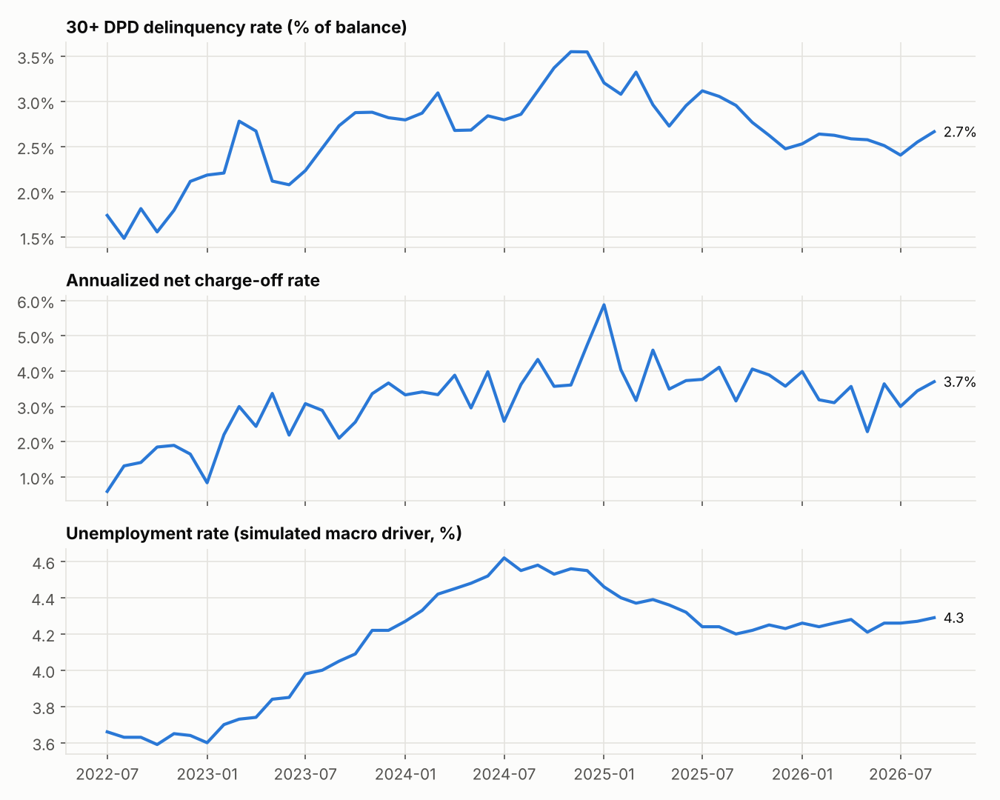
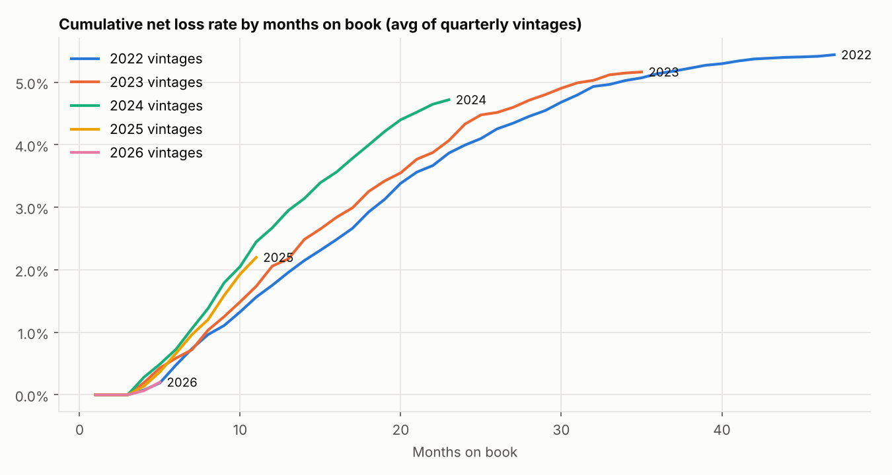
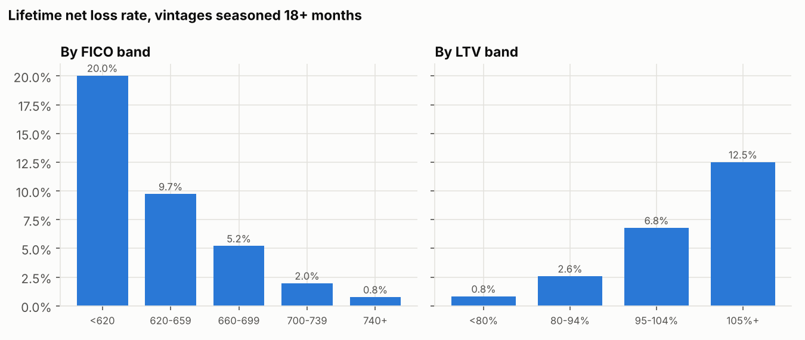
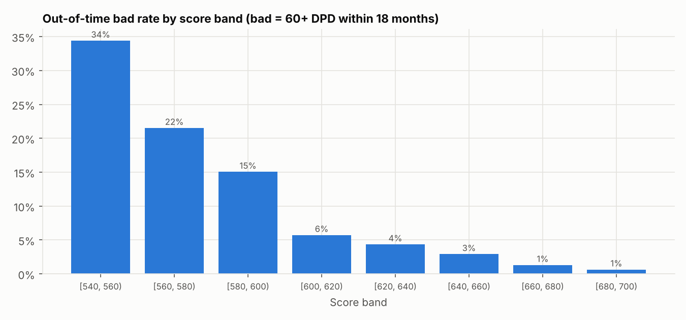
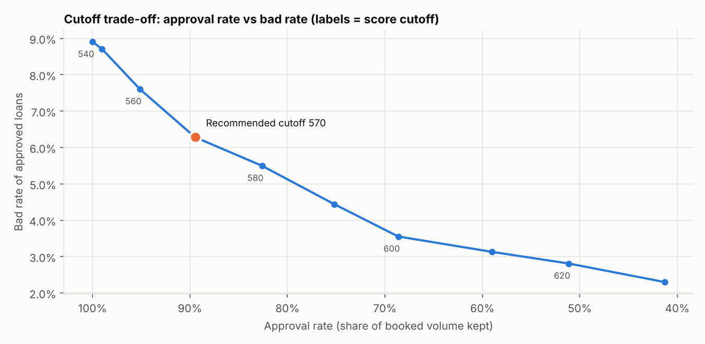
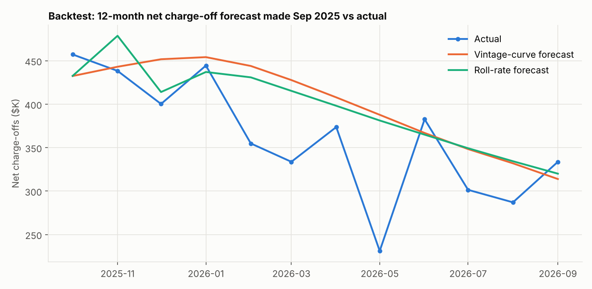

# Powersports Loan Portfolio – Credit Risk Analytics

This project is an end-to-end credit risk workflow for a consumer powersports loan book (motorcycles, ATVs, side-by-sides and watercraft). It uses SQL to track delinquency, vintage losses and roll rates, then uses Python to build an application scorecard, test score cutoffs for a decision engine and forecast the next 12 months of net charge-offs. Everything ends up in an Excel risk report.

All data is **synthetic**. A seeded simulator creates 25,000 loans and about 510,000 monthly performance records whose behavior resembles a real book. Loans season over time, losses respond to an unemployment index, and risk is driven by FICO, LTV, payment-to-income, DTI and term. No real customer or company data is used.



## Results (as of Sep 2026)

| Area | Result |
|---|---|
| Portfolio | 15,032 active accounts, **$136.6M** outstanding |
| Delinquency / losses | 30+ DPD **2.67%** of balance; annualized net charge-off rate **3.38%** (3-month average) |
| Segmentation | Seasoned net loss rate falls from **20.0%** for FICO under 620 to **0.8%** for 740+. Loans at 105%+ LTV lose **12.5%**, against **0.8%** under 80% LTV |
| Scorecard | Out-of-time **AUC 0.780 / Gini 0.561 / KS 0.454**; population stability (PSI) from development to out-of-time is **0.004** (stable) |
| Cutoff strategy | A cutoff of **570** keeps **89.5%** of volume. It lowers the approved bad rate from **8.9% to 6.3%** and avoids **$1.12M** of net losses for **$610K** of margin given up, a net profit gain of **$509K** on the out-of-time sample |
| Loss forecast | Next 12 months of net charge-offs on the existing book: **$3.94M** (vintage-curve method) and **$4.11M** (roll-rate method) |
| Backtest | Forecasts made as of Sep 2025 were **+10.9%** (vintage curve) and **+9.6%** (roll rate) above the **$4.34M** that actually charged off |

The full write-up is in [`reports/risk_memo.md`](reports/risk_memo.md), and the workbook is [`reports/credit_risk_report.xlsx`](reports/credit_risk_report.xlsx). The workbook has a dashboard sheet plus one sheet for each analysis.

## What's inside

| Step | Method | Code |
|---|---|---|
| Portfolio trend reporting | Monthly balances, 30+/60+ DPD rates, gross and net charge-offs, annualized NCO rate and the macro driver, using SQL window functions | `sql/delinquency_trend.sql` |
| Vintage analysis | Cumulative net loss rate by quarterly vintage and months on book | `sql/vintage_curves.sql` |
| Roll rates | Dollar-weighted transition matrix between current, 30, 60, 90+ DPD, charge-off and paid-off, built with `LEAD()` over each loan's history | `sql/roll_rates.sql` |
| Portfolio segmentation | Exposure, delinquency and seasoned loss rate by product, new/used, FICO band, LTV band and term | `sql/segmentation.sql` |
| Credit scorecard | Bad = 60+ DPD or charge-off within 18 months. Variables are binned with weight of evidence (WoE) and screened by information value (IV); the model is a logistic regression scaled to points (20 points to double the odds, 600 = 10:1). It is validated on an out-of-time sample with AUC, Gini, KS and PSI | `src/credit_risk/scorecard.py` |
| Decision-engine strategy | Bad rate, net loss rate and estimated margin for each score band; a table of cutoff trade-offs; the recommended cutoff is the most profitable one that still approves at least 85% of volume | `src/credit_risk/strategy.py` |
| Loss forecasting | (1) Vintage loss curve with an overlay calibrated to the last 6 months, (2) roll-rate Markov projection, plus a 12-month backtest of both | `src/credit_risk/forecast.py` |
| Reporting | Excel workbook with a KPI dashboard and charts (openpyxl), PNG charts and an auto-generated findings memo | `src/credit_risk/report.py`, `charts.py` |

<p float="left">
  
  
  
  
</p>



## How to run

```bash
git clone https://github.com/vinny-nguyen-4/powersports-credit-risk-analytics.git
cd powersports-credit-risk-analytics
python -m venv .venv && source .venv/bin/activate   # Windows: .venv\Scripts\activate
pip install -r requirements.txt
pip install -e .

python -m credit_risk.pipeline     # about 10 seconds: simulate, run SQL, train, forecast, build reports
pytest -q                          # 15 tests
```

The outputs are written to `reports/`, and the DuckDB database is written to `data/portfolio.duckdb`. You can query it directly:

```bash
duckdb data/portfolio.duckdb -c "SELECT product, COUNT(*) FROM loans GROUP BY 1"
```

Settings such as the seed, book size, bad definition, sample windows, score scaling, cost of funds and forecast horizon are in `src/credit_risk/config.py`. Any setting can be overridden with an environment variable, for example `N_LOANS=50000 python -m credit_risk.pipeline`.

## Project structure

```
sql/                  DuckDB SQL: delinquency trend, vintages, roll rates, segmentation
src/credit_risk/
  generate_data.py    seeded portfolio and monthly performance simulator
  db.py               load tables and run the SQL files (parameterized; whitelisted segments)
  scorecard.py        WoE/IV binning, logistic regression, points scaling, AUC/KS/PSI
  strategy.py         score-band economics and cutoff trade-off
  forecast.py         vintage-curve and roll-rate loss forecasts, backtest
  charts.py, report.py, pipeline.py
tests/                data integrity, SQL vs pandas reconciliation, model and forecast checks
reports/              Excel workbook, memo, charts (generated)
data/sample_loans.csv first 500 loans, for a quick look without running anything
```

## Skills demonstrated

- **Credit risk analytics:** portfolio performance, vintage analysis, roll rates, delinquency and charge-off trends, segmentation
- **Loss forecasting:** two independent methods, a calibration overlay and a backtest against actuals
- **Credit scoring:** WoE/IV, logistic regression, scorecard points, out-of-time validation (AUC, Gini, KS, PSI)
- **Decision-engine strategy:** cutoff setting, approval-rate versus bad-rate trade-off, a break-even economics view
- **Economic and trend analysis:** a macro (unemployment) driver and the lag between rising unemployment and charge-offs
- **SQL** (window functions, CTEs, parameterized queries), **Python** (pandas, NumPy, scikit-learn), **Excel** reporting and dashboards
- Clean engineering: reproducible seeded data, config-driven settings, 15 automated tests, CI on GitHub Actions

## Limitations

- The data is synthetic, so findings describe how the simulator behaves, not any real lender.
- Only booked loans are included. Declined applicants aren't simulated, so the scorecard has no reject inference.
- Recoveries are booked in the month of charge-off. Margin uses a simple APR spread (cost of funds, servicing cost and average life are set in config).
